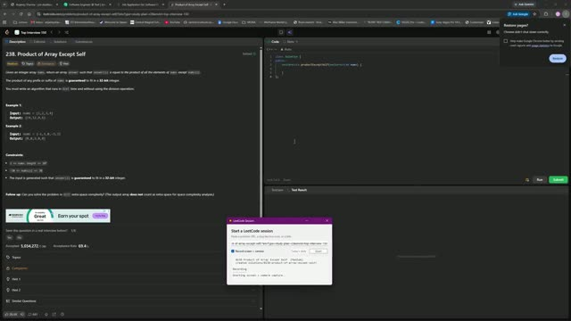

# 0238. Product of Array Except Self

 &nbsp;&middot;&nbsp; [Open on LeetCode](https://leetcode.com/problems/product-of-array-except-self/) &nbsp;&middot;&nbsp; Solved **2026-10-22**

`Array`  `Prefix Sum`

## Walkthrough

| Screen recording | Camera |
|:--:|:--:|
| [](media/screen.mp4)<br><sub>6m 16s &middot; 5 MB</sub> | [](media/camera.mp4)<br><sub>6m 13s &middot; 5 MB</sub> |

## Solution

### C++ <sub>[solution.cpp](solution.cpp)</sub>

```cpp
class Solution {
public:
    vector<int> productExceptSelf(vector<int>& nums) {
        vector<int> answer (nums.size(), 1);
        for(int i = 1; i < nums.size(); i++){
            answer[i] = nums[i-1] * answer[i-1];
        }
        int temp = 1;
        for(int i = nums.size() - 1; i >= 0; i--){
            answer[i] *= temp;
            temp *= nums[i];
        }

        return answer;
    }
};
```

## Problem

Given an integer array `nums`, return _an array_ `answer` _such that_ `answer[i]` _is equal to the product of all the elements of_ `nums` _except_ `nums[i]`.

The product of any prefix or suffix of `nums` is **guaranteed** to fit in a **32-bit** integer.

You must write an algorithm that runs in `O(n)` time and without using the division operation.

Example 1:**

```
**Input:** nums = [1,2,3,4]
**Output:** [24,12,8,6]

```
Example 2:**

```
**Input:** nums = [-1,1,0,-3,3]
**Output:** [0,0,9,0,0]

```

**Constraints:**

- `2 <= nums.length <= 10^5`

- `-30 <= nums[i] <= 30`

- The input is generated such that `answer[i]` is **guaranteed** to fit in a **32-bit** integer.

**Follow up:** Can you solve the problem in `O(1)` extra space complexity? (The output array **does not** count as extra space for space complexity analysis.)

---

<sub>Recorded and published with the [leetcode-journal](../../README.md) setup.</sub>
